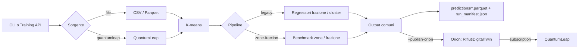

# Classificazione e previsione dei conferimenti rifiuti

Questo repository addestra modelli per:

- classificare i civici con K-means;
- prevedere i conferimenti per data e frazione;
- salvare risultati e metadati in file con un contratto comune;
- pubblicare, su richiesta, le previsioni come digital twin in Orion;
- eseguire inferenza con servizi ONNX sui modelli compatibili.

Sono supportate due pipeline di training e due sorgenti dati. Le due scelte sono
indipendenti:

| Scelta | Valori | Significato |
| --- | --- | --- |
| Pipeline | `legacy`, `zone-fraction` | Decide preparazione dati, feature e modelli |
| Sorgente | `file`, `quantumleap` | Decide da dove arriva lo storico |

Senza opzioni vengono usati `--pipeline legacy --source file`, per
retrocompatibilità.

## Scegliere la pipeline

| Pipeline | Quando usarla | Come lavora |
| --- | --- | --- |
| `legacy` | Compatibilità con il flusso precedente e con i servizi ONNX | K-means annuale, poi regressori raggruppati per frazione/cluster |
| `zone-fraction` | Dati completi di produzione e raccolta, calendario operativo e confronto tra più modelli | Costruisce i ritiri per zona/frazione/cluster, seleziona i modelli sulla validation e ripartisce i totali sui civici |

Tutte le combinazioni sono supportate:

| Pipeline | File | QuantumLeap | File futuri | Pubblicazione Orion |
| --- | --- | --- | --- | --- |
| `legacy` | sì | sì | sì | sì, tranne ARIMA |
| `zone-fraction` | sì | sì | sì | sì |

`--source complete-parquet` è ancora accettato, ma è un alias deprecato di
`--pipeline zone-fraction --source file`.

## Architettura



QuantumLeap è la sorgente dello storico. La pubblicazione avviene sempre verso
Orion; QuantumLeap riceve i digital twin tramite una subscription Orion. I file
di output vengono completati e validati prima dell'eventuale pubblicazione.

## Avvio rapido

### Ambiente locale

La pipeline usa Python 3.12 nel container. Per un ambiente locale isolato:

```bash
python3.12 -m venv .venv
.venv/bin/python -m pip install -r model-training/requirements.txt
```

`run_pipeline.sh` usa la variabile `PYTHON`; se non è impostata cerca
`./bin/python`. Negli esempi seguenti:

```bash
export PYTHON=.venv/bin/python
```

Per vedere tutte le opzioni senza avviare un training:

```bash
./run_pipeline.sh --help
```

### 1. Pipeline legacy da file

```bash
./run_pipeline.sh \
  --pipeline legacy \
  --source file \
  --anno 2024 \
  --annual-input data_csv_parquet/andria_distribuzione_annuale_zone_inferite_e_zone_costruzione.csv \
  --calendar-input data_csv_parquet/calendario_raccolta.csv \
  --output-dir artifacts/legacy-file-2024
```

Il flusso genera una distribuzione giornaliera sintetica a partire dal file
annuale e dal calendario, quindi addestra il regressore scelto. SGD è il
regressore predefinito.

### 2. Pipeline legacy da QuantumLeap

```bash
./run_pipeline.sh \
  --pipeline legacy \
  --source quantumleap \
  --from-date 2024-01-01 \
  --to-date 2024-12-31 \
  --output-dir artifacts/legacy-ql-2024
```

Lo storico giornaliero viene letto da QuantumLeap, aggregato per addestrare
K-means e poi classificato prima della regressione.

### 3. Pipeline zona/frazione da file

```bash
./run_pipeline.sh \
  --pipeline zone-fraction \
  --source file \
  --anno 2024 \
  --annual-input data_csv_parquet/andria_distribuzione_annuale_completa.parquet \
  --production-input data_csv_parquet/produzione_giornaliera_completa.parquet \
  --collections-input data_csv_parquet/conferimenti_giornalieri_completi.parquet \
  --calendar-input data_csv_parquet/calendario_raccolta.csv \
  --output-dir artifacts/zone-fraction-file-2024
```

`--output-dir` è obbligatorio per questa pipeline.

### 4. Pipeline zona/frazione da QuantumLeap

```bash
./run_pipeline.sh \
  --pipeline zone-fraction \
  --source quantumleap \
  --ql-collections-only \
  --from-date 2024-01-01 \
  --to-date 2024-12-31 \
  --calendar-input data_csv_parquet/calendario_raccolta.csv \
  --output-dir artifacts/zone-fraction-ql-2024
```

Con `--ql-collections-only`, questa modalità usa il solo storico dei
conferimenti e non richiede `produzione_teorica_t`, `conferimento_data` o
`raccolta_prevista`. Senza il flag resta attiva la validazione completa della
produzione teorica. Entrambe le modalità richiedono uno storico relativo a un
singolo anno.
Materializza in `artifacts/zone-fraction-ql-2024/inputs/` lo storico giornaliero
e gli snapshot usati dalla modalità file:

```text
inputs/
├── quantumleap_daily.parquet
├── annual.parquet
└── collections.parquet
```

`production.parquet` viene aggiunto solo quando il flag non è presente.

## Previsioni future e pubblicazione

Per creare un file futuro senza pubblicare nulla:

```bash
./run_pipeline.sh \
  --pipeline zone-fraction \
  --source file \
  --anno 2024 \
  --forecast-from-date 2025-01-01 \
  --forecast-to-date 2025-12-31 \
  --forecast-calendar data_csv_parquet/calendario_raccolta.csv \
  --output-dir artifacts/zone-fraction-forecast-2025
```

La pipeline `zone-fraction` include automaticamente il confronto
SARIMA/SARIMAX quando è richiesto un forecast. Per ogni frazione sceglie il
metodo usando, nell'ordine, WAPE di validation, RMSE e nome del modello. Il test
non partecipa alla selezione.

Per pubblicare lo stesso risultato in Orion, aggiungere `--publish-orion`:

```bash
./run_pipeline.sh \
  --pipeline zone-fraction \
  --source quantumleap \
  --from-date 2024-01-01 \
  --to-date 2024-12-31 \
  --calendar-input data_csv_parquet/calendario_raccolta.csv \
  --forecast-from-date 2025-01-01 \
  --forecast-to-date 2025-12-31 \
  --publish-orion \
  --output-dir artifacts/zone-fraction-ql-2024
```

Regole comuni:

- `--forecast-from-date` e `--forecast-to-date` devono essere presenti insieme;
- l'intervallo futuro deve iniziare dopo lo storico di training;
- `--publish-orion` richiede sempre l'intervallo futuro;
- `--publish-orion` funziona con entrambe le sorgenti;
- ARIMA della pipeline `legacy` produce solo file batch e non può essere
  pubblicato;
- il calendario passato con `--forecast-calendar` può essere diverso da quello
  di training.

Le date di training senza orario coprono l'intera giornata UTC:
`2024-01-01` diventa `2024-01-01T00:00:00Z` e `2024-12-31` diventa
`2024-12-31T23:59:59Z`. Se viene indicato un orario, il fuso è obbligatorio.

## Contratto degli input

### File legacy

L'input annuale predefinito è:

```text
data_csv_parquet/andria_distribuzione_annuale_zone_inferite_e_zone_costruzione.csv
```

Deve contenere almeno:

- `id_civico`;
- `anno` oppure `anno_produzione`;
- `zona_raccolta`;
- una colonna `<frazione>_t` per ogni frazione disponibile;
- le feature anagrafiche usate da K-means, come coordinate e densità.

Il totale `totale_t` è riconosciuto ma non viene usato come frazione.

### File zona/frazione

La pipeline usa quattro file:

| Input | Contenuto principale |
| --- | --- |
| `--annual-input` | Una riga per civico, anno, zona, quantità annuali per frazione e campi di qualità territoriale |
| `--production-input` | Produzione teorica giornaliera, data di conferimento e indicatore di raccolta prevista |
| `--collections-input` | Conferimenti osservati per civico, data e frazione |
| `--calendar-input` | Regole o date di raccolta per zona e frazione |

I percorsi predefiniti sono:

```text
data_csv_parquet/andria_distribuzione_annuale_completa.parquet
data_csv_parquet/produzione_giornaliera_completa.parquet
data_csv_parquet/conferimenti_giornalieri_completi.parquet
data_csv_parquet/calendario_raccolta.csv
```

La preparazione controlla chiavi, date, quantità non negative, coerenza tra
totali annuali e frazioni, calendario e riconciliazione fra produzione e
conferimenti. `cluster_label` viene calcolato dal K-means corrente e unito ai
conferimenti: non deve essere preparato manualmente nell'input.

### QuantumLeap

Ogni entità `RifiutiConferimento` rappresenta una frazione associata a un
civico. L'entity ID è opaco; un formato possibile è `2231596:vetro`.

La pipeline legacy richiede questi attributi:

| Attributo | Tipo atteso | Significato |
| --- | --- | --- |
| `id_civico` | Integer o Text | Identificatore, normalizzato internamente come testo |
| `frazione` | Text | Frazione del rifiuto |
| `anno_produzione` | Integer | Anno di riferimento |
| `coord_x`, `coord_y` | Number | Coordinate |
| `densita_locale` | Number | Densità locale |
| `zona_raccolta` | Integer o Text | Zona operativa |
| `zona_costruzione` | Text | Categoria urbanistica |
| `giorni_accumulati` | Number | Giorni confluiti nel conferimento |
| `conferimento_t` | Number | Quantità osservata in tonnellate |

La pipeline `zone-fraction` richiede inoltre:

| Attributo | Significato |
| --- | --- |
| `produzione_teorica_t` | Produzione teorica giornaliera |
| `conferimento_data` | Data a cui è assegnata la produzione |
| `raccolta_prevista` | Indicatore `0` o `1` |
| `prg_error` | Informazione di qualità PRG |
| `zona_raccolta_inferita` | Indicatore di zona inferita |
| `zona_costruzione_riassegnata` | Indicatore di riassegnazione |
| `distanza_inferenza_zona_raccolta_gradi` | Distanza usata nell'inferenza |
| `distanza_riassegnazione_prg` | Distanza usata nella riassegnazione |

La lettura fallisce in modo esplicito in presenza di attributi mancanti,
frazioni sconosciute, valori nulli o negativi, serie temporali non allineate o
campi statici in conflitto nello stesso civico/anno.

Frazioni riconosciute:

```text
altro_rd, carta_cartone, frazione_organica, ingombranti_misti,
legno, metallo, plastica, pulizia_stradale_recupero, raee,
rifiuti_cd, selettiva, tessili, vetro
```

`--ql-id-pattern` limita gli entity ID letti. Va usato solo se il filtro include
tutte le entità-frazione necessarie a calcolare totali annuali corretti.

### Calendario

Il CSV deve contenere `zona_raccolta`, `frazione` e uno tra:

- `weekday`, per una regola settimanale;
- `data`, per una data esplicita.

La colonna opzionale `raccolta` può disattivare una riga. Per
`zone-fraction`, il comportamento predefinito è
`--missing-calendar-mode error`: ogni coppia zona/frazione attiva deve essere
coperta. `--missing-calendar-mode daily` crea una raccolta giornaliera per le
coppie mancanti.

## Contratto degli output

Usare sempre `--output-dir` è consigliato, anche se è obbligatorio solo per
`zone-fraction`. In questo modo ogni esecuzione resta isolata:

```text
artifacts/<run>/
├── data/ o data_csv_parquet/    # dati derivati
├── inputs/                      # snapshot QL completi, solo zone-fraction/QL
├── metrics/ o *.csv             # metriche native
├── models/                      # modelli addestrati
├── predictions/
│   ├── test.parquet             # output comune, sempre presente
│   ├── future.parquet           # output comune, se richiesto
│   └── ...                      # output diagnostici nativi
└── run_manifest.json            # provenienza e hash degli artifact
```

`predictions/test.parquet` e `predictions/future.parquet` hanno le stesse
colonne per entrambe le pipeline:

| Colonna | Significato |
| --- | --- |
| `id_civico` | Civico; può essere nullo per output nativi aggregati |
| `data` | Data della previsione |
| `frazione` | Frazione |
| `prediction_t` | Previsione puntuale in tonnellate |
| `prediction_lower_t`, `prediction_upper_t` | Intervallo, se disponibile |
| `pipeline` | `legacy` oppure `zone-fraction` |
| `model` | Modello selezionato |
| `forecast_method` | Metodo realmente usato, incluso un eventuale fallback |
| `zona_raccolta` | Zona, se disponibile |
| `cluster_label` | Cluster, se disponibile |

`run_manifest.json` registra pipeline, sorgente, policy di selezione, input,
output, artifact e relativi SHA-256. Gli output specifici dei singoli modelli
restano disponibili per analisi e debug.

Il runner implementa un DAG basato su file: salta un nodo quando tutti i suoi
output sono più recenti degli input. Per ignorare la cache:

```bash
./run_pipeline.sh ... --force
```

Per ispezionare il grafo o i comandi senza eseguirli:

```bash
./run_pipeline.sh ... --print-graph
./run_pipeline.sh ... --dry-run
```

## Come funzionano i modelli

### Pipeline legacy

Il flusso è:

```text
storico annuale o giornaliero
→ aggregazione annuale
→ K-means per civico
→ righe giornaliere con cluster_label
→ regressore per frazione/cluster
→ test e forecast
```

Con `--source file`, le righe giornaliere sono generate dal totale annuale e
dal calendario. Con `--source quantumleap`, sono usate le osservazioni reali.

Regressori disponibili:

| `--regressor` | Uso |
| --- | --- |
| `sgd` | Default, lineare e scalabile |
| `gpr` | Gaussian Process esatto; campiona al massimo 500 righe per gruppo per default |
| `hist_gradient_boosting` | Modello non lineare su tutte le righe del gruppo |
| `arima` | Serie SARIMA giornaliere, solo output batch |

Esempi:

```bash
./run_pipeline.sh \
  --pipeline legacy \
  --source file \
  --regressor gpr \
  --gpr-max-train-rows 500 \
  --output-dir artifacts/legacy-gpr
```

```bash
./run_pipeline.sh \
  --pipeline legacy \
  --source file \
  --regressor hist_gradient_boosting \
  --output-dir artifacts/legacy-hgb
```

ARIMA può produrre una riga per gruppo:

```bash
./run_pipeline.sh \
  --pipeline legacy \
  --source file \
  --regressor arima \
  --arima-group-level \
  --forecast-from-date 2025-01-01 \
  --forecast-to-date 2025-12-31 \
  --output-dir artifacts/legacy-arima
```

Senza `--arima-group-level`, i totali vengono ripartiti sui civici e il
calendario futuro è obbligatorio. Con `--arima-group-level --arima-group-by
zone`, le serie sono raggruppate per zona invece che per cluster.

Le feature legacy includono dati anagrafici e di calendario, quantità storiche
annuali e medie per raccolta, più lag per civico/frazione. Validation, test e
forecast aggiornano i lag ricorsivamente senza leggere target futuri.

### Pipeline zona/frazione

Il flusso è:

```text
dati annuali + produzione + conferimenti + calendario
→ K-means e classificazione dei conferimenti
→ ritiri zona/frazione/cluster
→ feature temporali senza leakage
→ confronto dei modelli
→ selezione su validation
→ ripartizione sui civici
```

Lo split predefinito usa gennaio-settembre per il training,
ottobre-novembre per la validation e dicembre per il test. In alternativa:

```bash
./run_pipeline.sh \
  --pipeline zone-fraction \
  --source file \
  --validation-strategy k-fold \
  --validation-folds 5 \
  --output-dir artifacts/zone-fraction-kfold
```

Il benchmark tabellare confronta:

- ultimo ritiro, media mobile degli ultimi quattro ritiri e media del training;
- Ridge;
- SGD;
- histogram gradient boosting;
- quantili 0,50 e 0,90 per le frazioni episodiche.

Le feature comprendono calendario e festività italiane, intervallo dal ritiro
precedente, valore a sette giorni e statistiche dei ritiri precedenti. Tutte le
finestre escludono il target corrente. `cluster_label` è una feature dei
modelli tabellari.

Con `--include-arima` vengono confrontati anche SARIMA, SARIMAX e naive
stagionale a sette giorni. Questi modelli lavorano per zona/frazione e non
usano il cluster. I giorni non programmati restano osservazioni mancanti,
mentre SARIMAX usa intervallo dal ritiro precedente e festività come regressori
noti.

```bash
./run_pipeline.sh \
  --pipeline zone-fraction \
  --source file \
  --include-arima \
  --output-dir artifacts/zone-fraction-arima
```

La ripartizione del totale zona/frazione sui civici confronta quote storiche,
Bayesian Ridge ed empirical-Bayes Dirichlet. La scelta usa la validation,
richiede prima copertura sufficiente e poi minimizza il WAPE civico. La somma
delle previsioni civiche conserva il totale del gruppo.

Opzioni utili:

| Opzione | Effetto |
| --- | --- |
| `--exclude-episodic-fractions` | Esclude frazioni episodiche da training, metriche e output |
| `--hgb-loss poisson` | Loss HGB predefinita |
| `--hgb-loss squared_error` | Confronto HGB con errore quadratico |
| `--include-arima` | Aggiunge SARIMA/SARIMAX; implicito per i forecast futuri |
| `--validation-strategy k-fold` | Usa finestre temporali crescenti |

## Training API

La stessa pipeline è esposta da FastAPI. Creare e avviare l'immagine:

```bash
docker build --target api -f model-training/Dockerfile \
  -t waste-model-training-api .

mkdir -p artifacts
docker run --rm \
  --name waste-model-training-api \
  --user "$(id -u):$(id -g)" \
  --network fiware-quantumleap_fiware \
  -p 8002:8000 \
  -e QL_URL=http://fiware-quantumleap:8668 \
  -e ORION_URL=http://fiware-orion:1026 \
  -e FIWARE_SERVICE=openiot \
  -e FIWARE_SERVICE_PATH=/ \
  -v "$PWD/data_csv_parquet:/data:ro" \
  -v "$PWD/artifacts:/artifacts" \
  waste-model-training-api
```

Esempio `zone-fraction` da file:

```bash
curl -X POST http://localhost:8002/v1/training-jobs \
  -H 'Content-Type: application/json' \
  -d '{
    "pipeline": "zone-fraction",
    "source": "file",
    "year": 2024,
    "annual_input_path": "/data/andria_distribuzione_annuale_completa.parquet",
    "production_input_path": "/data/produzione_giornaliera_completa.parquet",
    "collections_input_path": "/data/conferimenti_giornalieri_completi.parquet",
    "calendar_input_path": "/data/calendario_raccolta.csv",
    "output_dir": "/artifacts/zone-fraction-file-2024",
    "forecast": {
      "forecast_from_date": "2025-01-01",
      "forecast_to_date": "2025-12-31"
    }
  }'
```

Esempio `zone-fraction` da QuantumLeap con pubblicazione:

```bash
curl -X POST http://localhost:8002/v1/training-jobs \
  -H 'Content-Type: application/json' \
  -d '{
    "pipeline": "zone-fraction",
    "source": "quantumleap",
    "from_date": "2024-01-01",
    "to_date": "2024-12-31",
    "calendar_input_path": "/data/calendario_raccolta.csv",
    "output_dir": "/artifacts/zone-fraction-ql-2024",
    "orion": {
      "forecast_from_date": "2025-01-01",
      "forecast_to_date": "2025-12-31"
    }
  }'
```

Usare `forecast` per creare solo i file e `orion` per creare i file e
pubblicarli. I due blocchi sono mutuamente esclusivi.

Per usare la pipeline legacy nell'API, impostare `"pipeline": "legacy"`. Una
richiesta da file richiede solo input annuale e calendario; una richiesta da
QuantumLeap usa il contratto di attributi legacy descritto sopra.

La risposta `202 Accepted` contiene `job_id`. Stato e salute:

```bash
curl http://localhost:8002/v1/training-jobs/JOB_ID
curl http://localhost:8002/healthz
```

Gli stati sono `queued`, `running`, `succeeded` e `failed`. Il processo accetta
un solo job attivo e risponde `409` alle richieste concorrenti. Stato e ID
restano in memoria e vengono persi al riavvio.

## Esecuzione batch in container

Creare l'immagine:

```bash
docker build -f model-training/Dockerfile -t waste-model-training .
```

Da file:

```bash
mkdir -p artifacts/container-file
docker run --rm \
  --user "$(id -u):$(id -g)" \
  -v "$PWD/data_csv_parquet:/app/data_csv_parquet:ro" \
  -v "$PWD/artifacts/container-file:/artifacts" \
  waste-model-training \
  --pipeline zone-fraction \
  --source file \
  --output-dir /artifacts
```

Da QuantumLeap:

```bash
mkdir -p artifacts/container-ql
docker run --rm \
  --user "$(id -u):$(id -g)" \
  --network fiware-quantumleap_fiware \
  -e QL_URL=http://fiware-quantumleap:8668 \
  -e FIWARE_SERVICE=openiot \
  -e FIWARE_SERVICE_PATH=/ \
  -v "$PWD/data_csv_parquet/calendario_raccolta.csv:/data/calendar.csv:ro" \
  -v "$PWD/artifacts/container-ql:/artifacts" \
  waste-model-training \
  --pipeline zone-fraction \
  --source quantumleap \
  --from-date 2024-01-01 \
  --to-date 2024-12-31 \
  --calendar-input /data/calendar.csv \
  --output-dir /artifacts
```

L'immagine non contiene i dataset sorgente. Su Linux, `--user` assegna gli
artifact all'utente corrente; senza override viene usato l'utente non
privilegiato `app` (UID 10001).

## FIWARE e digital twin

Orion e QuantumLeap devono usare gli stessi header tenant:

```text
Fiware-Service: openiot
Fiware-ServicePath: /
```

Servono due subscription permanenti:

- `RifiutiConferimento`, per salvare lo storico sorgente;
- `RifiutiDigitalTwin`, per salvare classificazioni e previsioni.

Il progetto non crea automaticamente subscription permanenti. Per creare solo
quelle mancanti:

```bash
python manage_fiware_subscriptions.py
```

Per rimuovere le subscription dei due tipi dirette allo stesso QuantumLeap:

```bash
python manage_fiware_subscriptions.py --remove
```

URL e tenant del gestore sono configurabili con `--orion-url`, `--notify-url`,
`--service` e `--service-path`, oppure con `ORION_URL`, `QL_NOTIFY_URL`,
`FIWARE_SERVICE` e `FIWARE_SERVICE_PATH`.

L'URL di notifica deve essere raggiungibile dal container Orion. Per esempio,
su una rete Docker può essere
`http://fiware-quantumleap:8668/v2/notify`; `localhost` indicherebbe Orion
stesso.

Ogni twin ha ID deterministico:

```text
urn:ngsi-v2:RifiutiDigitalTwin:<id_civico>:<anno_previsione>
```

Contenuto principale:

```json
{
  "id_civico": "2231596",
  "forecast_year": 2025,
  "classification_year": 2024,
  "cluster_label": 3,
  "cluster_distance": 0.42,
  "classifier_model_version": "sha256...",
  "regressor_model_version": "sha256...",
  "forecast_from": "2025-01-01T00:00:00Z",
  "forecast_to": "2025-12-31T23:59:59Z",
  "future_values": [
    {
      "date": "2025-01-07",
      "values_t": {"vetro": 0.25}
    }
  ]
}
```

Una nuova esecuzione aggiorna il twin dello stesso civico/anno. Le versioni dei
modelli sono hash SHA-256 degli artifact usati.

## Esportazione e servizi ONNX

I servizi supportano sia i modelli `legacy` sia quelli `zone-fraction`.
L'inferenza tabulare usa ONNX; i modelli SARIMAX `zone-fraction` restano nel
formato Joblib/Statsmodels nativo.

Installare le dipendenze degli esportatori:

```bash
.venv/bin/python -m pip install -r onnx_clustering/requirements-export.txt
.venv/bin/python -m pip install -r onnx_inference/requirements-export.txt
```

Esportare classificatore e regressori provenienti dalla stessa esecuzione:

```bash
.venv/bin/python onnx_clustering/export_model.py \
  --input artifacts/legacy-file-2024/models/kmeans_model_annuo_peso_coord.joblib \
  --output-dir .tmp/kmeans-onnx

.venv/bin/python onnx_inference/export_models.py \
  --input artifacts/legacy-file-2024/models/grouped_sgd_time_series.joblib \
  --output-dir .tmp/grouped-sgd-onnx
```

L'esportatore della regressione accetta anche bundle GPR e histogram gradient
boosting.

Esportare i modelli `zone-fraction` della stessa esecuzione:

```bash
.venv/bin/python onnx_clustering/export_model.py \
  --input artifacts/zone-fraction/models/kmeans_model.joblib \
  --output-dir .tmp/zone-fraction-kmeans

.venv/bin/python onnx_inference/export_models.py \
  --input artifacts/zone-fraction/models/zone_fraction_benchmark.joblib \
  --sarimax-input artifacts/zone-fraction/models/zone_fraction_arima.joblib \
  --output-dir .tmp/zone-fraction-runtime
```

Il pacchetto di regressione contiene il preprocessore tabulare fitted
(imputazione, indicatori dei valori mancanti, scaling e codifica), il regressore
convertito in ONNX e il bundle SARIMAX nativo senza conversione. Il bundle
SARIMAX può essere molto grande; resta nella directory montata in `/models` e
non viene incluso nell'immagine Docker. Usare una directory nuova per ogni
versione.

Creare e avviare i servizi:

```bash
docker build -f onnx_clustering/Dockerfile -t waste-onnx-clustering .
docker build -f onnx_inference/Dockerfile -t waste-onnx-inference .
```

```bash
docker run --rm --name waste-clustering \
  --network fiware-quantumleap_fiware \
  -p 8001:8000 \
  -v "$PWD/.tmp/kmeans-onnx:/models:ro" \
  -e QL_URL=http://fiware-quantumleap:8668 \
  -e ORION_URL=http://fiware-orion:1026 \
  -e FIWARE_SERVICE=openiot \
  -e FIWARE_SERVICE_PATH=/ \
  waste-onnx-clustering

docker run --rm --name waste-regression \
  --network fiware-quantumleap_fiware \
  -p 8000:8000 \
  -v "$PWD/.tmp/grouped-sgd-onnx:/models:ro" \
  -e QL_URL=http://fiware-quantumleap:8668 \
  -e ORION_URL=http://fiware-orion:1026 \
  -e FIWARE_SERVICE=openiot \
  -e FIWARE_SERVICE_PATH=/ \
  waste-onnx-inference
```

Verifica:

```bash
curl http://localhost:8001/readyz
curl http://localhost:8000/readyz
```

La documentazione interattiva è disponibile su `/docs`.

### Inferenza ONNX da QuantumLeap

Prima classificare e pubblicare le etichette:

```bash
curl -X POST http://localhost:8001/v1/predict/quantumleap \
  -H 'Content-Type: application/json' \
  -d '{
    "from_date": "2024-01-01T00:00:00Z",
    "to_date": "2024-12-31T23:59:59Z",
    "forecast_year": 2025,
    "civic_ids": ["2231596"]
  }'
```

Poi calcolare e pubblicare le previsioni:

```bash
curl -X POST http://localhost:8000/v1/forecast/quantumleap \
  -H 'Content-Type: application/json' \
  -d '{
    "from_date": "2024-01-01T00:00:00Z",
    "to_date": "2024-12-31T23:59:59Z",
    "forecast_from_date": "2025-01-01",
    "forecast_to_date": "2025-01-31",
    "civic_ids": ["2231596"]
  }'
```

Omettendo `civic_ids` vengono elaborati tutti i civici dell'intervallo. Il
secondo servizio attende brevemente la propagazione Orion → QuantumLeap delle
etichette prodotte dal primo.

Endpoint aggiuntivi:

| Servizio | Endpoint | Uso |
| --- | --- | --- |
| Clustering | `POST /v1/predict` | Classifica record annuali già preparati |
| Regressione | `POST /v1/predict` | Predice feature già preparate |
| Regressione | `POST /v1/predict/quantumleap` | Usa righe che possiedono già `cluster_label` |
| Regressione | `POST /v1/predict/zone-fraction` | Predice feature tabulari zona/frazione |
| Regressione | `POST /v1/forecast/zone-fraction` | Esegue forecast SARIMAX nativo per gruppo |
| Entrambi | `GET /healthz` | Verifica il processo |
| Entrambi | `GET /readyz` | Verifica che il modello sia caricato |

Il forecast SARIMAX usa il calendario configurato e restituisce totali per
zona, frazione e cluster. La disaggregazione sui civici continua a richiedere
gli input storici e statici della pipeline di training.

## Configurazione

| Variabile | Default | Utilizzata da |
| --- | --- | --- |
| `PYTHON` | `./bin/python` | Runner locale |
| `QL_URL` | `http://localhost:8668` | Pipeline e servizi |
| `ENTITY_TYPE` | `RifiutiConferimento` | Pipeline e servizi |
| `FIWARE_SERVICE` | `openiot` | Pipeline e servizi |
| `FIWARE_SERVICE_PATH` | `/` | Pipeline e servizi |
| `QL_TIMEOUT_SECONDS` | `30` | Pipeline e servizi |
| `ORION_URL` | `http://localhost:1026` | Pipeline e servizi |
| `QL_NOTIFY_URL` | `http://fiware-quantumleap:8668/v2/notify` | Gestore subscription |
| `ORION_TIMEOUT_SECONDS` | `30` | Pipeline e servizi |
| `ORION_TWIN_ENTITY_TYPE` | `RifiutiDigitalTwin` | Training |
| `TWIN_ENTITY_TYPE` | `RifiutiDigitalTwin` | Servizi ONNX |
| `ORION_BATCH_SIZE` | `20` | Training |
| `QL_LABEL_WAIT_SECONDS` | `5` | Regressore ONNX |
| `FORECAST_CALENDAR` | calendario incluso | Training e regressore ONNX |
| `MODEL_DIR` | `/models` | Servizi ONNX |

Le configurazioni FIWARE della CLI sono disponibili anche come opzioni
`--ql-*`, `--fiware-*` e `--orion-*`.

## Test e diagnostica

Suite configurata, senza servizi esterni:

```bash
.venv/bin/python -m pytest -q
```

Autoverifica del runner:

```bash
./run_pipeline.sh --self-check
```

Test con Orion e QuantumLeap locali:

```bash
RUN_ORION_INTEGRATION=1 \
  .venv/bin/python -m pytest -q test_orion_integration.py
```

Il test di integrazione crea entità e subscription temporanee, verifica il
flusso Orion → QuantumLeap → servizi ONNX → digital twin e infine rimuove i
dati di test.

Errori comuni:

| Errore | Controllo |
| --- | --- |
| File non trovato | Verificare il percorso rispetto alla radice del repository o i mount Docker |
| Calendario incompleto | Aggiungere la coppia zona/frazione o usare consapevolmente `--missing-calendar-mode daily` |
| Attributi QL mancanti | Usare il profilo completo richiesto da `zone-fraction` |
| Forecast rifiutato | Controllare che inizi dopo la fine dello storico |
| Nessun dato QL | Verificare tenant, entity type, intervallo e `--ql-id-pattern` |
| Twin non visibile in QL | Verificare la subscription `RifiutiDigitalTwin` e l'URL di notifica |
| Job API in `409` | Attendere la fine del job attivo |

## Limiti operativi

- Le query QuantumLeap senza filtro civici devono usare intervalli
  ragionevolmente limitati.
- La modalità QuantumLeap riacquisisce lo storico e riaddestra i modelli a ogni
  esecuzione.
- La pipeline legacy usa snapshot QuantumLeap temporanei; `zone-fraction` li
  conserva sotto `output-dir/inputs` per tracciabilità.
- La pubblicazione in Orion non avvia automaticamente un nuovo training.
- Retry automatici, autenticazione aggiuntiva, coda durevole dei job e
  deployment automatico dei modelli non fanno parte del flusso corrente.
- Gli upsert dei twin sono deterministici: una riesecuzione aggiorna lo stesso
  civico/anno.
