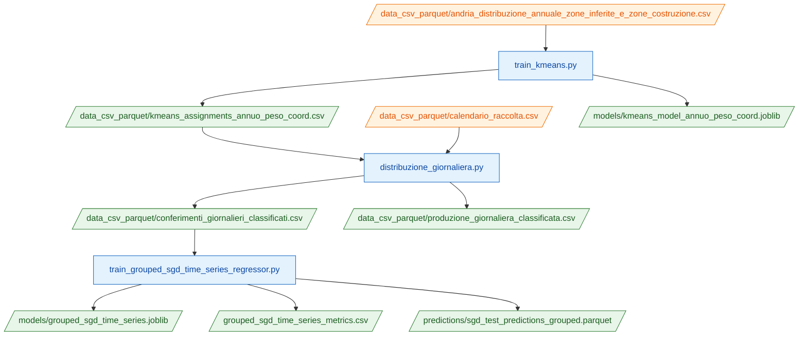

# Riepilogo

## ORDINE ESECUZIONE SCRIPT

il seed è sempre 42

Sequenza manuale:

Oppure eseguire tutto come grafo di dipendenze sui file:

```bash
./run_pipeline.sh
```

Il runner salta gli step con output più recenti degli input. Per forzare tutto:

```bash
./run_pipeline.sh --force
```

1. classificazione K-means sul CSV annuo:

    ```bash
    python model-training/classification/train_kmeans.py --input data_csv_parquet/andria_distribuzione_annuale_zone_inferite_e_zone_costruzione.csv --n-clusters 6 --output data_csv_parquet/kmeans_assignments_annuo_peso_coord.csv --output-format csv --model-output models/kmeans_model_annuo_peso_coord.joblib --coord-weight 8 --annual-kg-weight 0.5 --other-numeric-weight 1 --categorical-weight 1
    ```

2. calcolo della produzione e conferimento giornaliero dal CSV annuo classificato:

    ```bash
    python dataset/distribuzione_giornaliera.py --annuo data_csv_parquet/kmeans_assignments_annuo_peso_coord.csv --anno 2024 --calendario data_csv_parquet/calendario_raccolta.csv --id-col "id_civico" --zona-col "zona_raccolta" --seed 42 --out data_csv_parquet/conferimenti_giornalieri_classificati.csv --out-produzione data_csv_parquet/produzione_giornaliera_classificata.csv --missing-calendar-mode daily
    ```

    (il missing-calendar-mode daily serve perché la pulizia stradale avviene ogni giorno)
3. addestramento regressore SGD raggruppato per frazione e cluster:

    ```bash
    python model-training/regression/train_grouped_sgd_time_series_regressor.py --input data_csv_parquet/conferimenti_giornalieri_classificati.csv --split-ratios 80,10,10 --epochs 3 --batch-size 4096 --predictions-output predictions/sgd_test_predictions_grouped.parquet --progress
    ```

## GRAFO DIPENDENZE



| Step | Dipendenze in ingresso | Dipendenze in uscita |
| --- | --- | --- |
| 1 | `data_csv_parquet/andria_distribuzione_annuale_zone_inferite_e_zone_costruzione.csv` | `data_csv_parquet/kmeans_assignments_annuo_peso_coord.csv`, `models/kmeans_model_annuo_peso_coord.joblib` |
| 2 | `data_csv_parquet/kmeans_assignments_annuo_peso_coord.csv`, `data_csv_parquet/calendario_raccolta.csv` | `data_csv_parquet/conferimenti_giornalieri_classificati.csv`, `data_csv_parquet/produzione_giornaliera_classificata.csv` |
| 3 | `data_csv_parquet/conferimenti_giornalieri_classificati.csv` | `models/grouped_sgd_time_series.joblib`, `grouped_sgd_time_series_metrics.csv`, `predictions/sgd_test_predictions_grouped.parquet` |

## ONNX inference service

Install the exporter dependencies and convert the grouped scikit-learn bundle:

```bash
bin/python -m pip install -r onnx_inference/requirements-export.txt
bin/python onnx_inference/export_models.py \
  --input models/grouped_sgd_time_series.joblib \
  --output-dir .tmp/grouped-sgd-onnx
```

The output contains `manifest.json` and one ONNX model for every
`frazione`/`cluster_label` group. The exporter refuses to overwrite an existing
directory; use a new directory for each model version.

Build and run the CPU inference container with the package mounted read-only:

```bash
docker build -f onnx_inference/Dockerfile -t waste-onnx-inference .
docker run --rm -p 8000:8000 \
  -v "$PWD/.tmp/grouped-sgd-onnx:/models:ro" \
  waste-onnx-inference
```

Check readiness and request predictions:

```bash
curl http://localhost:8000/readyz
curl -X POST http://localhost:8000/v1/predict \
  -H 'Content-Type: application/json' \
  -d '{
    "instances": [{
      "data": "2024-09-10",
      "anno_produzione": 2024,
      "coord_x": 16.2896597,
      "coord_y": 41.2407249,
      "densita_locale": 384.0,
      "giorni_accumulati": 3,
      "zona_raccolta": 1,
      "frazione": "altro_rd",
      "cluster_label": 5
    }]
  }'
```

To deploy a new model, export it to a new directory and restart the container
with that directory mounted at `/models`. The REST contract does not change.

Run the exporter and API checks with:

```bash
bin/python -m pytest onnx_inference/test_inference.py
```

## ONNX clustering service

Convert the annual K-means bundle into a versioned ONNX package:

```bash
bin/python -m pip install -r onnx_clustering/requirements-export.txt
bin/python onnx_clustering/export_model.py \
  --input models/kmeans_model_annuo_peso_coord.joblib \
  --output-dir .tmp/kmeans-onnx
```

Build and run the standalone clustering service on host port 8001:

```bash
docker build -f onnx_clustering/Dockerfile -t waste-onnx-clustering .
docker run --rm -p 8001:8000 \
  -v "$PWD/.tmp/kmeans-onnx:/models:ro" \
  waste-onnx-clustering
```

The service uses the same health, readiness, and batched prediction envelope as
the regressor. The annual fields are required; `zona_costruzione` may be null.

```bash
curl http://localhost:8001/readyz
curl -X POST http://localhost:8001/v1/predict \
  -H 'Content-Type: application/json' \
  -d '{
    "instances": [{
      "anno_produzione": 2024,
      "coord_x": 16.3149866,
      "coord_y": 41.2333986,
      "densita_locale": 397,
      "altro_rd_t": 4.47,
      "carta_cartone_t": 76.623,
      "frazione_organica_t": 266.098,
      "ingombranti_misti_t": 139.054,
      "legno_t": 0,
      "metallo_t": 2.527,
      "plastica_t": 22.206,
      "pulizia_stradale_recupero_t": 0,
      "raee_t": 0,
      "rifiuti_cd_t": 0,
      "selettiva_t": 0,
      "tessili_t": 0,
      "vetro_t": 28.849,
      "zona_raccolta": 2,
      "zona_costruzione": "B3R"
    }]
  }'
```

The response contains `cluster_label` and the nearest-centroid
`cluster_distance`. Pass the label to the grouped regressor. Because K-means
labels can change after retraining, deploy clustering and regressor packages
trained from the same assignments together.

Run the clustering checks with:

```bash
bin/python -m pytest onnx_clustering/test_clustering.py
```
