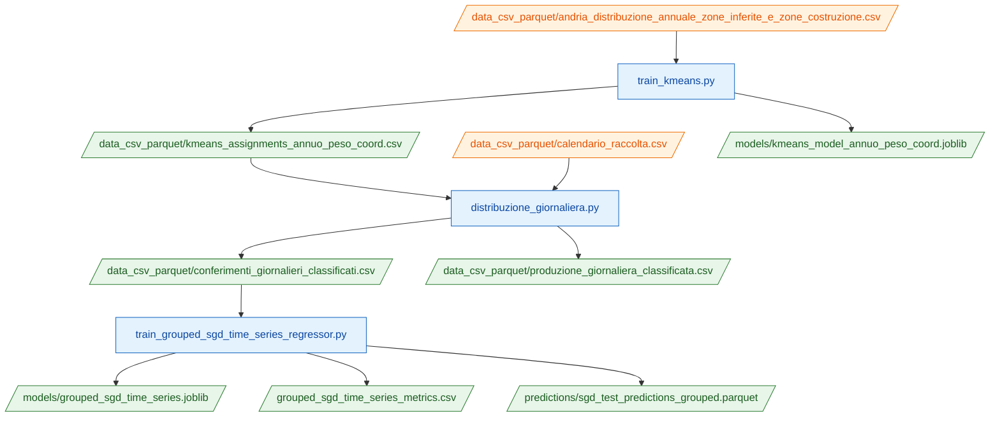

# Riepilogo

## ORDINE ESECUZIONE SCRIPT

il seed è sempre 42

Sequenza manuale:

Oppure eseguire tutto come grafo di dipendenze sui file:

```bash
./run_pipeline.sh
```

Il runner salta gli step con output più recenti degli input. Per forzare tutto:

```bash
./run_pipeline.sh --force
```

1. classificazione K-means sul CSV annuo:

    ```bash
    python model-training/classification/train_kmeans.py --input data_csv_parquet/andria_distribuzione_annuale_zone_inferite_e_zone_costruzione.csv --n-clusters 6 --output data_csv_parquet/kmeans_assignments_annuo_peso_coord.csv --output-format csv --model-output models/kmeans_model_annuo_peso_coord.joblib --coord-weight 8 --annual-kg-weight 0.5 --other-numeric-weight 1 --categorical-weight 1
    ```

2. calcolo della produzione e conferimento giornaliero dal CSV annuo classificato:

    ```bash
    python dataset/distribuzione_giornaliera.py --annuo data_csv_parquet/kmeans_assignments_annuo_peso_coord.csv --anno 2024 --calendario data_csv_parquet/calendario_raccolta.csv --id-col "id_civico" --zona-col "zona_raccolta" --seed 42 --out data_csv_parquet/conferimenti_giornalieri_classificati.csv --out-produzione data_csv_parquet/produzione_giornaliera_classificata.csv --missing-calendar-mode daily
    ```

    (il missing-calendar-mode daily serve perché la pulizia stradale avviene ogni giorno)
3. addestramento regressore SGD raggruppato per frazione e cluster:

    ```bash
    python model-training/regression/train_grouped_sgd_time_series_regressor.py --input data_csv_parquet/conferimenti_giornalieri_classificati.csv --split-ratios 80,10,10 --epochs 3 --batch-size 4096 --predictions-output predictions/sgd_test_predictions_grouped.parquet --progress
    ```

## GRAFO DIPENDENZE



| Step | Dipendenze in ingresso | Dipendenze in uscita |
| --- | --- | --- |
| 1 | `data_csv_parquet/andria_distribuzione_annuale_zone_inferite_e_zone_costruzione.csv` | `data_csv_parquet/kmeans_assignments_annuo_peso_coord.csv`, `models/kmeans_model_annuo_peso_coord.joblib` |
| 2 | `data_csv_parquet/kmeans_assignments_annuo_peso_coord.csv`, `data_csv_parquet/calendario_raccolta.csv` | `data_csv_parquet/conferimenti_giornalieri_classificati.csv`, `data_csv_parquet/produzione_giornaliera_classificata.csv` |
| 3 | `data_csv_parquet/conferimenti_giornalieri_classificati.csv` | `models/grouped_sgd_time_series.joblib`, `grouped_sgd_time_series_metrics.csv`, `predictions/sgd_test_predictions_grouped.parquet` |
