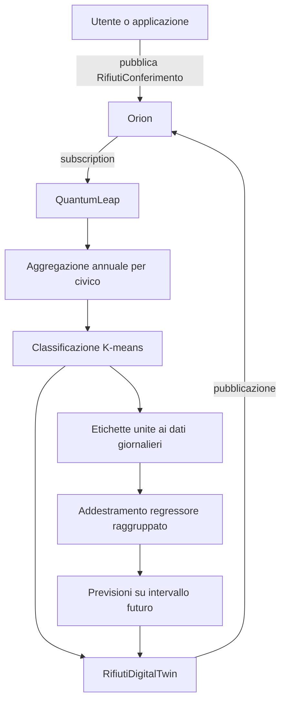

# Classificazione e previsione dei conferimenti rifiuti

Questo progetto addestra e distribuisce due modelli:

- un classificatore K-means, che assegna ogni civico a un cluster usando i dati
  annuali;
- un regressore selezionabile, raggruppato per frazione e cluster, che stima le
  tonnellate dei conferimenti futuri.

I dati possono provenire da file locali oppure da QuantumLeap. I risultati
possono essere pubblicati in Orion come entità `RifiutiDigitalTwin` e quindi
salvati nuovamente in QuantumLeap tramite subscription Orion.

## Flusso completo



Esistono due modalità operative:

1. **Pipeline di addestramento**: legge lo storico, ricostruisce entrambi i
   modelli e, facoltativamente, pubblica classificazioni e previsioni.
2. **Servizi ONNX**: usano modelli già esportati. Il servizio di clustering
   classifica e pubblica le etichette; il servizio di regressione legge le
   etichette da QuantumLeap, calcola il futuro e aggiorna gli stessi twin.

I servizi ONNX eseguono solo inferenza: non addestrano e non aggiornano i file
dei modelli.

## Prerequisiti FIWARE

Orion e QuantumLeap devono essere raggiungibili. Tutte le richieste devono usare
gli stessi header tenant:

```text
Fiware-Service: openiot
Fiware-ServicePath: /
```

Servono due subscription permanenti:

- `RifiutiConferimento`, per salvare in QuantumLeap i dati pubblicati dagli
  utenti;
- `RifiutiDigitalTwin`, per salvare classificazioni e previsioni.

Esempio per la prima subscription:

```bash
curl -i -X POST http://localhost:1026/v2/subscriptions \
  -H 'Content-Type: application/json' \
  -H 'Fiware-Service: openiot' \
  -H 'Fiware-ServicePath: /' \
  -d '{
    "description": "Storico conferimenti in QuantumLeap",
    "subject": {
      "entities": [{
        "idPattern": ".*",
        "type": "RifiutiConferimento"
      }]
    },
    "notification": {
      "http": {
        "url": "http://fiware-quantumleap:8668/v2/notify"
      }
    }
  }'
```

Creare la seconda subscription con lo stesso comando, sostituendo tipo e
descrizione con `RifiutiDigitalTwin`. L'URL di notifica deve essere raggiungibile
dal container Orion: `localhost` indicherebbe Orion stesso, non QuantumLeap.

Il progetto non crea automaticamente subscription permanenti.

Per creare soltanto le subscription mancanti:

```bash
python manage_fiware_subscriptions.py
```

Per rimuovere le subscription dei due tipi dirette allo stesso URL QuantumLeap:

```bash
python manage_fiware_subscriptions.py --remove
```

URL e tenant possono essere modificati con `--orion-url`, `--notify-url`,
`--service` e `--service-path` oppure tramite le variabili d'ambiente
`ORION_URL`, `QL_NOTIFY_URL`, `FIWARE_SERVICE` e `FIWARE_SERVICE_PATH`.

## Schema dei dati sorgente

Ogni entità `RifiutiConferimento` rappresenta una frazione associata a un
civico. L'entity ID è opaco; un formato possibile è `2231596:vetro`.

Attributi richiesti:

| Attributo | Tipo atteso | Significato |
| --- | --- | --- |
| `id_civico` | Integer o Text | Identificatore del civico; internamente viene normalizzato come testo |
| `frazione` | Text | Nome della frazione |
| `anno_produzione` | Integer | Anno di riferimento |
| `coord_x`, `coord_y` | Number | Coordinate del civico |
| `densita_locale` | Number | Densità locale |
| `zona_raccolta` | Integer o Text | Zona da 1 a 4 |
| `zona_costruzione` | Text | Categoria urbanistica |
| `giorni_accumulati` | Number | Giorni confluiti nel conferimento |
| `conferimento_t` | Number | Quantità in tonnellate |

Frazioni riconosciute:

```text
altro_rd, carta_cartone, frazione_organica, ingombranti_misti,
legno, metallo, plastica, pulizia_stradale_recupero, raee,
rifiuti_cd, selettiva, tessili, vetro
```

Gli attributi richiesti devono essere presenti e allineati nello storico
QuantumLeap. La pipeline rifiuta frazioni sconosciute, valori nulli, array
temporali non allineati e conflitti nei campi statici dello stesso civico/anno.

## Pipeline di addestramento

Il comando principale è:

```bash
./run_pipeline.sh
```

### Benchmark sui Parquet completi

Il nuovo flusso batch per ritiro programmato usa direttamente i tre Parquet
completi. Prima della regressione addestra K-means sui dati annuali dei civici
e aggiunge `cluster_label` a ogni riga del Parquet dei conferimenti:

```bash
./run_pipeline.sh \
  --source complete-parquet \
  --output-dir artifacts/zone-fraction-seed42
```

I percorsi predefiniti sono
`andria_distribuzione_annuale_completa.parquet`,
`produzione_giornaliera_completa.parquet` e
`conferimenti_giornalieri_completi.parquet` nella directory
`data_csv_parquet`. Possono essere sostituiti con `--annual-input`,
`--production-input` e `--collections-input`.

La preparazione proietta e aggrega i Parquet con DuckDB per
zona/frazione/cluster, riconcilia produzione, conferimenti e totali annuali,
completa i ritiri a zero dal calendario e mantiene lo spillover. Il training si
ferma al 31 dicembre e usa lo split cronologico gennaio-settembre,
ottobre-novembre e dicembre; confronta baseline, Ridge, il regressore lineare
SGD del flusso precedente e histogram gradient boosting, e produce anche i
quantili 0,50 e 0,90 per le frazioni episodiche.
`cluster_label` è una feature categorica del modello tabellare e identifica le
serie usate da Ridge, SGD e histogram gradient boosting. SARIMA e SARIMAX
aggregano invece i cluster e addestrano una serie per coppia zona/frazione.

Per selezionare il modello con cross-validation temporale a finestra crescente,
lasciando dicembre come test finale:

```bash
./run_pipeline.sh \
  --source complete-parquet \
  --validation-strategy k-fold \
  --validation-folds 5 \
  --output-dir artifacts/zone-fraction-seed42
```

La strategia predefinita resta `fixed`, con ottobre-novembre come intervallo di
validation. `--validation-folds` viene usato soltanto dalla strategia `k-fold`.

Per escludere completamente le frazioni episodiche da training, selezione,
metriche e predizioni:

```bash
./run_pipeline.sh \
  --source complete-parquet \
  --exclude-episodic-fractions \
  --output-dir artifacts/zone-fraction-seed42
```

Le feature storiche comprendono il ritiro precedente, il valore osservato
esattamente sette giorni prima, le statistiche degli ultimi quattro ritiri e
media, somma e conteggio dei ritiri nei sette giorni precedenti. Tutte le
finestre escludono il target corrente.

La loss HGB predefinita è `poisson`. Per un confronto esplicito:

```bash
./run_pipeline.sh \
  --source complete-parquet \
  --hgb-loss squared_error \
  --output-dir artifacts/zone-fraction-squared-error
```

Per eseguire anche il confronto SARIMA/SARIMAX per zona e frazione:

```bash
./run_pipeline.sh \
  --source complete-parquet \
  --exclude-episodic-fractions \
  --include-arima \
  --output-dir artifacts/zone-fraction-seed42
```

SARIMA usa una frequenza giornaliera e stagionalità settimanale, ma mantiene i
giorni non programmati come osservazioni mancanti invece di trasformarli in
target zero. SARIMAX viene selezionato e valutato in parallelo, usando come
regressori noti l'intervallo dal ritiro programmato precedente e le festività
nazionali italiane (con il giorno successivo); le festività non modificano il
calendario di raccolta. Ordine e ordine stagionale vengono scelti sul WAPE di
validation; il test viene confrontato anche con il valore osservato sette
giorni prima.
Anche il sottocomando `arima` accetta `--validation-strategy k-fold` e
`--validation-folds`; in questa modalità seleziona gli ordini sul WAPE medio
dei fold temporali.

I totali di test di SARIMA, SARIMAX e della baseline stagionale vengono inoltre
ripartiti su tutti i civici della stessa zona. I pesi
sono calcolati esclusivamente dai conferimenti precedenti al 1 dicembre; i
civici senza storico ricevono peso zero e, se tutto il gruppo è privo di
storico, vengono usate quote uguali. Il riepilogo stampa il WAPE aggregato,
quello per civico e il relativo incremento.

Per le frazioni incluse, la ripartizione confronta il peso storico con un
`BayesianRidge` e un modello empirico-Bayes Dirichlet. La selezione usa
ottobre-novembre, richiede prima una copertura almeno del 90% e poi minimizza
il WAPE civico. Le previsioni di dicembre includono gli estremi inferiore e
superiore; ogni previsione puntuale continua a sommare esattamente al totale
zona/frazione. Il benchmark non usa produzione o conferimenti futuri e non usa
`cluster_label`, perché deriva dai totali annuali completi.

Gli output principali sono:

```text
artifacts/zone-fraction-seed42/
├── data/kmeans_assignments.parquet
├── data/conferimenti_giornalieri_classificati.parquet
├── data/static_civics.parquet
├── data/withdrawals/scenario_seed=42/part-000.parquet
├── manifest.json
├── models/kmeans_model.joblib
├── metrics/zone_fraction_benchmark_metrics.csv
├── metrics/zone_fraction_arima_civic_metrics.csv
├── metrics/zone_fraction_arima_allocator_benchmark.csv
├── models/zone_fraction_benchmark.joblib
├── predictions/zone_fraction_test_predictions.parquet
└── predictions/zone_fraction_arima_test_predictions_per_civic.parquet
```

Il flusso corrente dichiara `scenario_seed=42`; il seed non viene usato come
feature. `--missing-calendar-mode error` è il comportamento predefinito e può
essere sostituito esplicitamente con `daily`.

La sorgente predefinita è il file locale. Il flusso eseguito è:

```text
CSV annuale → K-means → distribuzione giornaliera sintetica
             → regressore raggruppato SGD, GPR, histogram gradient boosting o ARIMA
```

La distribuzione giornaliera aggiunge anche `historical_annual_t` e
`historical_collection_mean_t`. Per le previsioni future rappresentano
rispettivamente l'ultima quantità annua osservata per civico/frazione e la sua
media per raccolta pianificata.

Il regressore calcola inoltre, senza pubblicarli, i lag per civico/frazione:
ultimo conferimento, somme dei 7 e 30 giorni precedenti, mediana e conteggio
dei 90 giorni precedenti e giorni dall'ultimo conferimento positivo. Validation,
test e forecast aggiornano questi lag ricorsivamente con le previsioni, senza
leggere target futuri.

Il runner salta gli step i cui output sono già più recenti degli input. Per
rieseguirli:

```bash
./run_pipeline.sh --force
```

Per provare un nuovo addestramento senza sovrascrivere modelli, metriche e dati
generati già in uso, indicare una directory isolata:

```bash
./run_pipeline.sh --source quantumleap \
  --from-date 2024-01-01T00:00:00Z \
  --to-date 2024-12-31T23:59:59Z \
  --output-dir artifacts/prova-2024
```

SGD resta il regressore predefinito. Per addestrare invece i 72
`GaussianProcessRegressor` raggruppati per frazione e cluster:

```bash
./run_pipeline.sh --regressor gpr \
  --gpr-max-train-rows 500 \
  --output-dir artifacts/gpr-2024 \
  --force
```

GPR esatto non scala a milioni di righe per gruppo. La pipeline divide quindi
cronologicamente il train set di ogni gruppo in un massimo di 500 intervalli e
sceglie una riga deterministica per intervallo. Il limite è configurabile; le
metriche e le previsioni continuano a essere calcolate sugli split completi.

Per addestrare un `HistGradientBoostingRegressor` su tutte le righe di ogni
gruppo, con loss Poisson e valutazione cronologica ricorsiva:

```bash
./run_pipeline.sh \
  --source file \
  --anno 2024 \
  --regressor hist_gradient_boosting \
  --output-dir artifacts/hist-gradient-boosting-2024 \
  --force
```

I 72 gruppi vengono elaborati in sequenza, quindi in memoria viene caricato un
solo gruppo alla volta. A differenza di GPR, questo modello non applica un limite
al numero di righe di training.

Per addestrare invece 72 serie giornaliere SARIMA, una per coppia
`frazione`/`cluster_label`, e produrre previsioni future per civico:

```bash
./run_pipeline.sh \
  --regressor arima \
  --arima-group-level \
  --forecast-from-date 2025-01-07 \
  --forecast-to-date 2025-12-31 \
  --output-dir artifacts/arima-2024 \
  --force
```

La pipeline somma i conferimenti di ogni gruppo su un calendario giornaliero,
riempie con zero i giorni mancanti e confronta modelli con stagionalità
settimanale su tre finestre di validation espandibili. Per ogni gruppo seleziona
il SARIMA con RMSE medio più basso e riporta anche il benchmark stagionale
naive `y[t-7]`; il test finale resta separato dalla selezione. Con
`--arima-group-level` il processo si ferma qui e
scrive una riga per data, frazione e cluster, senza richiedere un calendario di
raccolta. Senza il flag, ogni totale viene invece ripartito tra i civici in
raccolta quel giorno in proporzione alla quantità annua storica della frazione;
in questo caso `--forecast-calendar` è obbligatorio per le previsioni future.
Se un SARIMA diventa numericamente non finito su un lungo orizzonte futuro,
quel gruppo usa il benchmark settimanale e lo segnala in `forecast_method`.
ARIMA è disponibile soltanto come output batch: non viene esportato in ONNX né
pubblicato in Orion.

Per prevedere invece i conferimenti secondo la loro unità operativa naturale,
si possono addestrare 48 serie `frazione`/`zona_raccolta` usando il calendario
originale del gestore:

```bash
./run_pipeline.sh \
  --regressor arima \
  --arima-group-level \
  --arima-group-by zone \
  --calendar-input data_csv_parquet/calendario_raccolta.csv \
  --forecast-from-date 2025-01-07 \
  --forecast-to-date 2025-12-31 \
  --output-dir artifacts/arima-zone-2024 \
  --force
```

Questa modalità mantiene separati modello, metriche e previsioni tramite nomi
di artifact con suffisso `zone_level` o `by_zone`.

`--output-dir` mantiene al suo interno la stessa struttura standard:

```text
artifacts/prova-2024/
├── data_csv_parquet/     # output derivati della modalità file
├── models/               # classificatore e regressore
├── predictions/          # previsioni del test set
└── grouped_<regressor>_time_series_metrics.csv
```

Gli input sorgente non vengono copiati o modificati. Gli snapshot QuantumLeap
restano temporanei. Il flag isola soltanto i file locali: se viene aggiunto
anche `--publish-orion`, i digital twin vengono comunque pubblicati in Orion.

### Esecuzione in container

Creare l'immagine della pipeline:

```bash
docker build -f model-training/Dockerfile -t waste-model-training .
```

I dati sorgente e gli artefatti non sono inclusi nell'immagine. Per addestrare
da file locali, montare i dati in sola lettura e una directory separata per gli
output:

```bash
mkdir -p artifacts/container-file
docker run --rm \
  --user "$(id -u):$(id -g)" \
  -v "$PWD/data_csv_parquet:/app/data_csv_parquet:ro" \
  -v "$PWD/artifacts/container-file:/artifacts" \
  waste-model-training \
  --source file --output-dir /artifacts --force
```

Per addestrare da QuantumLeap, collegare il job alla rete FIWARE e fornire gli
stessi parametri del runner locale:

```bash
mkdir -p artifacts/container-quantumleap
docker run --rm \
  --user "$(id -u):$(id -g)" \
  --network fiware-quantumleap_fiware \
  -e QL_URL=http://fiware-quantumleap:8668 \
  -e FIWARE_SERVICE=openiot \
  -e FIWARE_SERVICE_PATH=/ \
  -v "$PWD/artifacts/container-quantumleap:/artifacts" \
  waste-model-training \
  --source quantumleap \
  --from-date 2024-01-01 \
  --to-date 2024-12-31 \
  --output-dir /artifacts
```

Tutte le opzioni mostrate da `./run_pipeline.sh --help`, incluse quelle per la
pubblicazione Orion, possono essere aggiunte dopo il nome dell'immagine. Su
Linux, `--user` fa sì che gli artefatti nei bind mount appartengano all'utente
che avvia il container; senza override l'immagine usa l'utente non privilegiato
`app` (UID 10001).

### API di addestramento on demand

Il target `api` della stessa immagine espone la pipeline tramite FastAPI senza
modificare il comportamento predefinito dell'immagine batch:

```bash
docker build --target api -f model-training/Dockerfile \
  -t waste-model-training-api .

mkdir -p "$PWD/artifacts"
docker run --rm \
  --name waste-model-training-api \
  --user "$(id -u):$(id -g)" \
  --network fiware-quantumleap_fiware \
  -p 8002:8000 \
  -e QL_URL=http://fiware-quantumleap:8668 \
  -e ORION_URL=http://fiware-orion:1026 \
  -e FIWARE_SERVICE=openiot \
  -e FIWARE_SERVICE_PATH=/ \
  -v "$PWD/data_csv_parquet:/data:ro" \
  -v "$PWD/artifacts:/artifacts" \
  waste-model-training-api
```

Avviare un job usando file locali al nodo/container:

```bash
curl -X POST http://localhost:8002/v1/training-jobs \
  -H 'Content-Type: application/json' \
  -d '{
    "source": "file",
    "year": 2024,
    "seed": 42,
    "regressor": "gpr",
    "gpr_max_train_rows": 500,
    "annual_input_path": "/data/andria_distribuzione_annuale_zone_inferite_e_zone_costruzione.csv",
    "calendar_input_path": "/data/calendario_raccolta.csv",
    "output_dir": "/artifacts/file-2024",
    "force": false
  }'
```

Per un job ARIMA aggregato, impostare `"regressor": "arima"`, aggiungere
`"arima_group_level": true` e il blocco opzionale `forecast`; senza questo
blocco viene omesso soltanto il file futuro:

```json
"forecast": {
  "forecast_from_date": "2025-01-07",
  "forecast_to_date": "2025-12-31"
}
```

Oppure leggere lo storico da QuantumLeap e, facoltativamente, pubblicare i
digital twin in Orion:

```bash
curl -X POST http://localhost:8002/v1/training-jobs \
  -H 'Content-Type: application/json' \
  -d '{
    "source": "quantumleap",
    "seed": 42,
    "from_date": "2024-01-01",
    "to_date": "2024-12-31",
    "output_dir": "/artifacts/quantumleap-2024",
    "orion": {
      "forecast_from_date": "2025-01-01",
      "forecast_to_date": "2025-12-31",
      "forecast_calendar_path": "/data/calendario_raccolta.csv"
    }
  }'
```

La risposta `202 Accepted` contiene `job_id`. Consultare lo stato con:

```bash
curl http://localhost:8002/v1/training-jobs/JOB_ID
curl http://localhost:8002/healthz
```

Gli stati sono `queued`, `running`, `succeeded` e `failed`. Il servizio accetta
un solo job attivo e risponde `409` alle richieste concorrenti. Gli ID e gli
stati restano in memoria e vengono persi al riavvio. I percorsi relativi sono
risolti rispetto alla radice del progetto; i percorsi assoluti sono limitati
dai permessi del processo e dai mount del container. Il servizio verifica che
`output_dir` sia creabile e scrivibile prima di accettare il job.

### Addestramento da QuantumLeap

```bash
./run_pipeline.sh --source quantumleap \
  --from-date 2024-01-01 \
  --to-date 2024-12-31
```

Le date senza orario indicano l'intera giornata in UTC: la data iniziale viene
convertita in `00:00:00Z` e quella finale in `23:59:59Z`. Se si specifica anche
l'orario, il fuso orario è obbligatorio, per esempio
`2024-01-01T00:00:00+01:00` oppure `2024-01-01T00:00:00Z`.

Il flusso QuantumLeap è:

```text
fetch storico
→ aggregazione delle 13 frazioni per civico/anno
→ addestramento K-means
→ classificazione di ogni riga giornaliera
→ addestramento del regressore selezionato per frazione/cluster
```

Le frazioni note assenti vengono valorizzate a zero. Gli snapshot Parquet sono
temporanei e vengono eliminati al termine. Poiché gli input sono ricreati a ogni
esecuzione, la modalità QuantumLeap riaddestra entrambi i modelli ogni volta.

`--ql-id-pattern` può limitare gli entity ID, ma il pattern deve includere tutte
le entità-frazione necessarie per ottenere totali annuali corretti.

### Addestramento e pubblicazione dei twin

```bash
./run_pipeline.sh --source quantumleap \
  --from-date 2024-01-01T00:00:00Z \
  --to-date 2024-12-31T23:59:59Z \
  --publish-orion \
  --forecast-from-date 2025-01-01 \
  --forecast-to-date 2025-12-31
```

L'intervallo futuro deve iniziare dopo `--to-date`. La pipeline genera prima
tutti i twin in uno snapshot temporaneo e pubblica in Orion solo se
classificazione e regressione terminano correttamente.

Output persistenti principali:

| Output | Contenuto |
| --- | --- |
| `models/kmeans_model_annuo_peso_coord.joblib` | Modello K-means |
| `models/grouped_sgd_time_series.joblib` | Regressori raggruppati |
| `grouped_sgd_time_series_metrics.csv` | Metriche train/validation/test |
| `predictions/sgd_test_predictions_grouped.parquet` | Previsioni sul test set |
| `models/grouped_gpr_time_series.joblib` | Regressori GPR raggruppati, se selezionati |
| `grouped_gpr_time_series_metrics.csv` | Metriche GPR train/validation/test |
| `predictions/gpr_test_predictions_grouped.parquet` | Previsioni GPR sul test set |
| `models/grouped_hist_gradient_boosting_time_series.joblib` | Regressori histogram gradient boosting raggruppati |
| `grouped_hist_gradient_boosting_time_series_metrics.csv` | Metriche histogram gradient boosting |
| `predictions/hist_gradient_boosting_test_predictions_grouped.parquet` | Previsioni histogram gradient boosting |
| `models/grouped_arima_time_series.joblib` | 72 modelli SARIMA giornalieri raggruppati |
| `grouped_arima_time_series_metrics.csv` | Metriche aggregate e per-civico ARIMA |
| `predictions/arima_test_predictions_per_civic.parquet` | Previsioni ARIMA per-civico sul test set |
| `predictions/arima_future_predictions_per_civic.parquet` | Previsioni future per-civico, se richieste |
| `models/grouped_arima_time_series_group_level.joblib` | Modelli SARIMA salvati dalla modalità aggregata |
| `grouped_arima_time_series_group_level_metrics.csv` | Metriche aggregate della modalità group-level |
| `predictions/arima_test_predictions_grouped.parquet` | Totali ARIMA per data/frazione/cluster sul test set |
| `predictions/arima_future_predictions_grouped.parquet` | Totali ARIMA futuri, con `--arima-group-level` |

Per vedere il grafo senza eseguirlo:

```bash
./run_pipeline.sh --source quantumleap \
  --from-date 2024-01-01T00:00:00Z \
  --to-date 2024-12-31T23:59:59Z \
  --print-graph
```

## Digital twin

Viene creata un'entità per civico e anno:

```text
urn:ngsi-v2:RifiutiDigitalTwin:<id_civico>:<anno_previsione>
```

Contenuto principale:

```json
{
  "id_civico": "2231596",
  "forecast_year": 2025,
  "classification_year": 2024,
  "cluster_label": 3,
  "cluster_distance": 0.42,
  "classifier_model_version": "sha256...",
  "regressor_model_version": "sha256...",
  "forecast_from": "2025-01-01T00:00:00Z",
  "forecast_to": "2025-12-31T23:59:59Z",
  "future_values": [
    {
      "date": "2025-01-07",
      "values_t": {"vetro": 0.25}
    }
  ]
}
```

`future_values` contiene solo le date di conferimento previste dal calendario
`data_csv_parquet/calendario_raccolta.csv`. Una nuova esecuzione aggiorna la
stessa entità invece di crearne una duplicata.

## Esportazione ONNX

Installare le dipendenze degli esportatori nell'ambiente virtuale:

```bash
bin/python -m pip install -r onnx_clustering/requirements-export.txt
bin/python -m pip install -r onnx_inference/requirements-export.txt
```

Esportare i due pacchetti:

```bash
bin/python onnx_clustering/export_model.py \
  --input models/kmeans_model_annuo_peso_coord.joblib \
  --output-dir .tmp/kmeans-onnx

bin/python onnx_inference/export_models.py \
  --input models/grouped_sgd_time_series.joblib \
  --output-dir .tmp/grouped-sgd-onnx
```

L'esportatore accetta anche i bundle GPR e histogram gradient boosting; il
servizio di inferenza e la pubblicazione dei twin espongono in ogni caso la sola
previsione media.

Ogni directory contiene `manifest.json` e i modelli ONNX. Gli esportatori non
sovrascrivono directory esistenti: usare una nuova directory per ogni versione.
Classificatore e regressore devono provenire dalla stessa esecuzione di
addestramento, perché le etichette dei cluster possono cambiare.

## Avvio dei servizi ONNX

Creare le immagini:

```bash
docker build -f onnx_clustering/Dockerfile -t waste-onnx-clustering .
docker build -f onnx_inference/Dockerfile -t waste-onnx-inference .
```

Esempio sulla rete Docker locale `fiware-quantumleap_fiware`:

```bash
docker run --rm --name waste-clustering \
  --network fiware-quantumleap_fiware \
  -p 8001:8000 \
  -v "$PWD/.tmp/kmeans-onnx:/models:ro" \
  -e QL_URL=http://fiware-quantumleap:8668 \
  -e ORION_URL=http://fiware-orion:1026 \
  -e FIWARE_SERVICE=openiot \
  -e FIWARE_SERVICE_PATH=/ \
  waste-onnx-clustering

docker run --rm --name waste-regression \
  --network fiware-quantumleap_fiware \
  -p 8000:8000 \
  -v "$PWD/.tmp/grouped-sgd-onnx:/models:ro" \
  -e QL_URL=http://fiware-quantumleap:8668 \
  -e ORION_URL=http://fiware-orion:1026 \
  -e FIWARE_SERVICE=openiot \
  -e FIWARE_SERVICE_PATH=/ \
  waste-onnx-inference
```

Verificare lo stato:

```bash
curl http://localhost:8001/readyz
curl http://localhost:8000/readyz
```

La documentazione interattiva FastAPI è disponibile su `/docs` per entrambi i
servizi.

## Inferenza ONNX da QuantumLeap

Il flusso consigliato usa due chiamate esplicite.

### 1. Classificare e pubblicare le etichette

```bash
curl -X POST http://localhost:8001/v1/predict/quantumleap \
  -H 'Content-Type: application/json' \
  -d '{
    "from_date": "2024-01-01T00:00:00Z",
    "to_date": "2024-12-31T23:59:59Z",
    "forecast_year": 2025,
    "civic_ids": ["2231596"]
  }'
```

Il servizio legge tutti i record nel periodo, filtra i civici richiesti senza
perdere le rispettive frazioni, aggrega per anno, esegue K-means e pubblica le
etichette nei twin Orion. Omettendo `civic_ids` vengono elaborati tutti i civici
del periodo richiesto. `forecast_year` identifica l'anno del digital twin; le
date esatte dell'intervallo sono richieste soltanto dalla regressione.

### 2. Calcolare e pubblicare le previsioni

Eseguire questa chiamata dopo la precedente:

```bash
curl -X POST http://localhost:8000/v1/forecast/quantumleap \
  -H 'Content-Type: application/json' \
  -d '{
    "from_date": "2024-01-01T00:00:00Z",
    "to_date": "2024-12-31T23:59:59Z",
    "forecast_from_date": "2025-01-01",
    "forecast_to_date": "2025-01-31",
    "civic_ids": ["2231596"]
  }'
```

Il regressore legge i dati sorgente e le etichette twin da QuantumLeap. Attende
brevemente l'eventuale propagazione Orion → QuantumLeap, calcola i conferimenti
futuri e aggiorna gli stessi twin in Orion.

Altri endpoint disponibili:

| Servizio | Endpoint | Uso |
| --- | --- | --- |
| Clustering | `POST /v1/predict` | Classificazione diretta di record annuali già preparati |
| Regressione | `POST /v1/predict` | Regressione diretta di feature già preparate e classificate |
| Regressione | `POST /v1/predict/quantumleap` | Previsione sulle righe storiche che possiedono già `cluster_label` |
| Entrambi | `GET /healthz` | Processo attivo |
| Entrambi | `GET /readyz` | Modello caricato e pronto |

Codici di errore principali:

| Codice | Significato |
| --- | --- |
| 404 | Nessun dato o nessuna etichetta twin disponibile |
| 422 | Intervallo non valido, categoria o gruppo modello sconosciuto |
| 502 | Risposta upstream o dati QuantumLeap malformati |
| 504 | Timeout QuantumLeap o Orion |

## Configurazione

| Variabile | Predefinito | Utilizzata da |
| --- | --- | --- |
| `QL_URL` | `http://localhost:8668` | Pipeline e servizi |
| `ENTITY_TYPE` | `RifiutiConferimento` | Pipeline e servizi |
| `FIWARE_SERVICE` | `openiot` | Pipeline e servizi |
| `FIWARE_SERVICE_PATH` | `/` | Pipeline e servizi |
| `QL_TIMEOUT_SECONDS` | `30` | Pipeline e servizi |
| `ORION_URL` | `http://localhost:1026` | Pipeline e servizi |
| `ORION_TIMEOUT_SECONDS` | `30` | Pipeline e servizi |
| `ORION_TWIN_ENTITY_TYPE` | `RifiutiDigitalTwin` | Pipeline di addestramento |
| `TWIN_ENTITY_TYPE` | `RifiutiDigitalTwin` | Servizi ONNX |
| `ORION_BATCH_SIZE` | `20` | Pipeline di addestramento |
| `QL_LABEL_WAIT_SECONDS` | `5` | Regressore ONNX |
| `FORECAST_CALENDAR` | calendario incluso | Pipeline e regressore ONNX |
| `MODEL_DIR` | `/models` | Servizi ONNX |

Le stesse configurazioni della pipeline possono essere fornite tramite opzioni
`--ql-*`, `--fiware-*` e `--orion-*`. Consultare l'elenco completo con:

```bash
./run_pipeline.sh --help
```

## Test e verifica

Suite completa senza servizi esterni:

```bash
bin/python -m pytest -q
```

Autoverifica del grafo di addestramento:

```bash
./run_pipeline.sh --self-check
```

Test di sistema con Orion e QuantumLeap locali:

```bash
RUN_ORION_INTEGRATION=1 \
  bin/python -m pytest -q test_orion_integration.py
```

Il test di sistema crea tipi, entità e subscription temporanei, verifica il
flusso Orion → QuantumLeap → ONNX clustering → twin → ONNX regressione e infine
rimuove i dati di test.

## Limiti operativi

- Le richieste senza `civic_ids` devono comunque usare periodi temporali
  ragionevolmente limitati.
- La pipeline QuantumLeap riaddestra sempre i modelli; non riusa automaticamente
  un modello esistente.
- Pubblicare in Orion non avvia automaticamente la pipeline di addestramento.
- Autenticazione aggiuntiva, retry automatici, creazione delle subscription e
  deployment automatico dei nuovi modelli sono fuori dal flusso corrente.
- La pubblicazione dei twin usa upsert deterministici: una riesecuzione aggiorna
  il twin dello stesso civico/anno.
